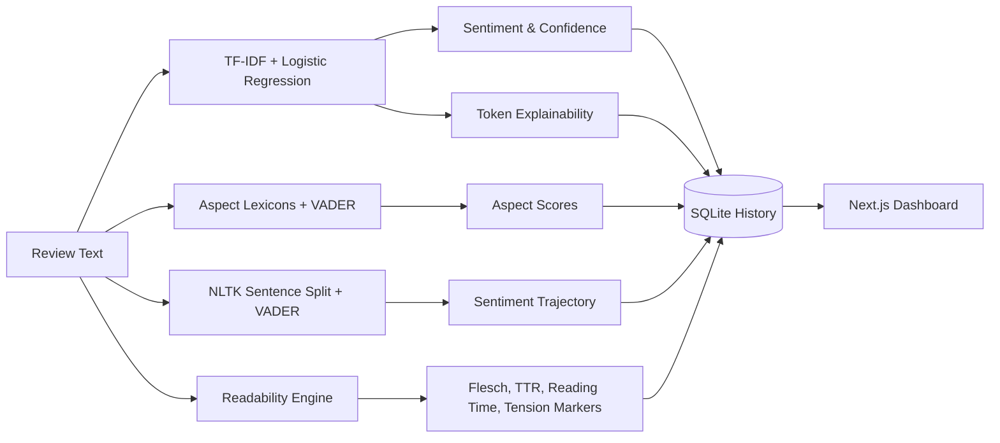
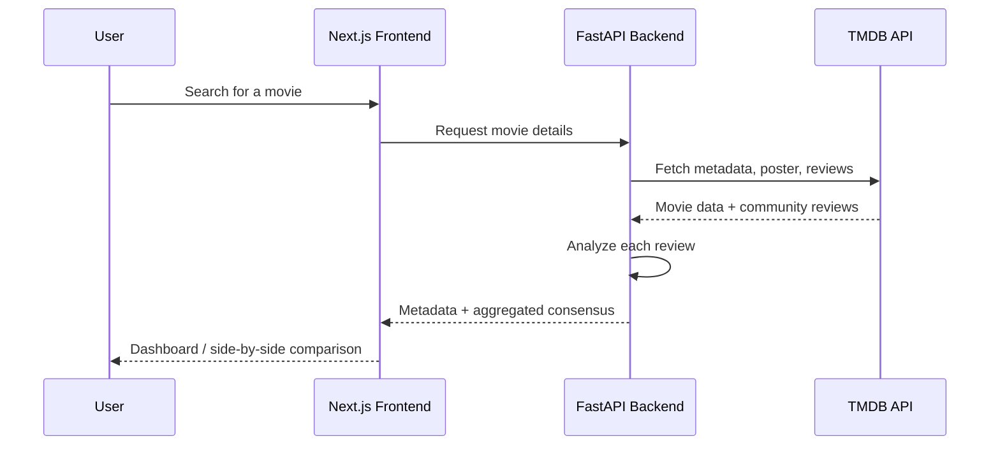

# CriticLens 🎬🔍

> **Full-Stack Text Intelligence & Multidimensional Movie Review Analytics Platform**

CriticLens is an end-to-end NLP platform that turns raw movie reviews into actionable, multidimensional analytics. Moving beyond binary sentiment classification, it breaks each review into aspect-based scores, sentence-level emotional trajectories, token-level model explanations (XAI), and lexical readability metrics. Integrated with The Movie Database (TMDB) API, it also provides audience consensus aggregation and side-by-side film comparison.

---

## 📑 Table of Contents

- [Key Features](#-key-features-the-4-pillars-of-intelligence)
- [Tech Stack](#-tech-stack)
- [System Architecture](#%EF%B8%8F-system-architecture)
- [How the Analysis Works](#-how-the-analysis-works)
- [Project Structure](#-project-structure)
- [Getting Started](#-getting-started)

---

## 🌟 Key Features (The 4 Pillars of Intelligence)

- **Pillar 1: Aspect-Based Polarity Breakdown.** Evaluates domain-specific components independently (*Acting & Cast*, *Story & Writing*, *Visuals & Audio*, and *Pacing & Direction*) using targeted lexicon matching and VADER polarity scoring.
- **Pillar 2: Narrative Sentiment Trajectory.** Tracks emotional shifts across the review, plotting sentence-by-sentence polarity to highlight narrative turning points.
- **Pillar 3: Token Explainability (XAI).** Unpacks the model's decision-making by mapping TF-IDF vocabulary tokens to the underlying logistic regression coefficients.
- **Pillar 4: Lexical & Readability Index.** Computes Flesch Reading Ease, vocabulary diversity (Type-Token Ratio), reading-time estimates, and contrastive tension markers (*e.g., "however", "although"*).
- **Movie Catalog & Consensus Aggregation.** Syncs with the TMDB REST API to retrieve movie metadata, posters, and community reviews.
- **Side-by-Side Comparison.** Compares audience consensus metrics across multiple films.
- **Persistent Evaluation History.** Stores recent inferences in an SQLite database with full CRUD capabilities.

---

## 🛠 Tech Stack

| Layer | Technologies |
|---|---|
| **Frontend** | Next.js (App Router), React, TypeScript, Tailwind CSS, Recharts, Framer Motion, Lucide Icons |
| **Backend** | FastAPI, Python, Uvicorn, SQLAlchemy, Pydantic |
| **ML & NLP** | Scikit-Learn (`TfidfVectorizer` + `LogisticRegression`), NLTK, VADER Sentiment, Joblib |
| **Data & Services** | SQLite, The Movie Database (TMDB) REST API v3 |

---

## 🏗️ System Architecture

```text
[ Next.js Frontend (React / TypeScript) ]
                │
                │  HTTP / REST (JSON)
                ▼
[ FastAPI Backend (Uvicorn ASGI Server) ]
    ├── Scikit-Learn Pipeline  ──► Global Sentiment & Confidence
    ├── NLTK & VADER Engine    ──► Aspect Scores & Sentence Trajectory
    ├── Model Coefficient Map  ──► Token Explainability (XAI)
    ├── Readability Engine     ──► Flesch Score & Lexical Diversity
    │
    ├──► [ SQLite DB ]      (SQLAlchemy persistence)
    │
    └──► [ TMDB REST API ]  (Posters, metadata, reviews)
```

---

## 🧠 How the Analysis Works

Each submitted review flows through four parallel analysis engines, and the combined results are returned to the dashboard and saved to history.



1. **Global sentiment.** A TF-IDF vectorizer feeds a logistic regression classifier, which outputs the predicted label and a confidence score.
2. **Aspect scoring.** Sentences are matched against curated lexicons for each aspect, and VADER computes compound polarity for the matched text. Aspects with no matching sentences are reported as `null`.
3. **Trajectory.** The review is split into sentences with NLTK, and each sentence receives a VADER compound score, producing a timeline of emotional shifts.
4. **Explainability.** Tokens in the review are looked up in the TF-IDF vocabulary and multiplied by their logistic regression coefficients to show which words pushed the prediction toward positive or negative.
5. **Readability.** Flesch Reading Ease, Type-Token Ratio, estimated reading time, and a count of contrastive connectors are computed directly from the text.

The TMDB integration works alongside this pipeline:



---

## 📁 Project Structure

> Adjust this to match your actual repository layout.

```text
criticlens/
├── backend/
│   ├── app/
│   │   ├── main.py            # FastAPI entry point
│   │   ├── routers/           # API route modules
│   │   ├── services/          # NLP, aspect, readability, TMDB logic
│   │   ├── models/            # SQLAlchemy models
│   │   ├── schemas/           # Pydantic schemas
│   │   └── ml/                # Trained pipeline (.joblib)
│   ├── requirements.txt
│   └── .env.example
├── frontend/
│   ├── app/                   # Next.js App Router pages
│   ├── components/            # Charts, cards, UI components
│   ├── lib/                   # API client & helpers
│   ├── package.json
│   └── .env.local.example
└── README.md
```

---

## 🚀 Getting Started

### Prerequisites

- Python 3.10+
- Node.js 18+ and npm (or pnpm / yarn)
- A free [TMDB API key](https://www.themoviedb.org/settings/api)

### 1. Clone the repository

```bash
git clone https://github.com/<your-username>/criticlens.git
cd criticlens
```

### 2. Backend setup

```bash
cd backend
python -m venv venv
source venv/bin/activate        # Windows: venv\Scripts\activate
pip install -r requirements.txt

# Download required NLTK data
python -c "import nltk; nltk.download('punkt'); nltk.download('punkt_tab'); nltk.download('vader_lexicon')"

# Create your env file and add your TMDB API key
cp .env.example .env

# Run the API
uvicorn app.main:app --reload --port 8000
```

The API is now available at `http://localhost:8000`, with interactive docs at `http://localhost:8000/docs`.

### 3. Frontend setup

```bash
cd frontend
npm install
cp .env.local.example .env.local   # points the frontend at the backend URL
npm run dev
```

The app is now available at `http://localhost:3000`.